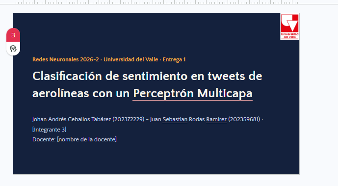

# Twitter Sentiment Analysis

Clasificador de sentimientos para tweets relacionados con aerolíneas. El programa
clasifica cada tweet en una de tres categorías:

- `negative`
- `neutral`
- `positive`

El flujo actual utiliza:

1. Limpieza básica del texto.
2. Representación TF-IDF con unigramas y bigramas.
3. Un MLP implementado con TensorFlow/Keras.
4. Pesos de clase para reducir el efecto del desbalance del dataset.
5. Evaluación con accuracy, F1, reporte por clase y matriz de confusión.
6. Un programa de línea de comandos para probar tweets nuevos.

## Estructura del proyecto

```text
data/
  Tweets.csv       Dataset original
  train.csv        Datos de entrenamiento
  val.csv          Datos de validación
  test.csv         Datos de prueba

src/
  make_split.py    Generación de los splits
  preprocess.py    Limpieza y vectorización TF-IDF
  model.py         Construcción del MLP
  train.py         Entrenamiento y guardado del modelo
  evaluate.py      Métricas y figuras de evaluación
  predict.py       Demo para clasificar tweets nuevos
  experiments.py   Comparación de configuraciones del MLP

artifacts/
  best_model.keras
  preprocessing.pkl
  metrics.json
  classification_report.txt
  confusion_matrix.png
  loss_curves.png
```

La carpeta `artifacts/` se crea después del entrenamiento y está ignorada por
Git porque contiene modelos y resultados generados.

## Requisitos

- Windows.
- Python 3.10 o superior.
- Dependencias de [`requirements.txt`](requirements.txt).

Se recomienda ejecutar los comandos desde la raíz del proyecto. En PowerShell,
la carpeta actual puede cambiarse con:

```powershell
cd "ruta\al\proyecto"
```

## 1. Instalar las dependencias

Crear un entorno virtual es opcional, pero recomendado:

```powershell
python -m venv .venv
.\.venv\Scripts\Activate.ps1
```

Instalar las dependencias:

```powershell
python -m pip install -r requirements.txt
```

Comprobar que TensorFlow está disponible:

```powershell
python -c "import tensorflow as tf; print(tf.__version__)"
```

En Windows, TensorFlow puede mostrar un aviso indicando que no se utilizará GPU.
Eso no impide ejecutar el proyecto: el entrenamiento se realiza con CPU.

## 2. Comprobar los datos

Los splits ya incluidos en `data/` son:

- `train.csv`: entrenamiento.
- `val.csv`: validación.
- `test.csv`: evaluación final.

Cada archivo debe contener las columnas:

```text
text,airline_sentiment
```

Si es necesario regenerar los splits a partir de `Tweets.csv`, ejecutar:

```powershell
python src/make_split.py
```

El script utiliza una semilla fija (`42`) y división estratificada para conservar
la proporción de clases.

## 3. Entrenar el modelo

Ejecutar:

```powershell
python src/train.py
```

El entrenamiento:

1. Lee `train.csv`, `val.csv` y `test.csv`.
2. Limpia menciones, enlaces, símbolos y convierte el texto a minúsculas.
3. Ajusta TF-IDF únicamente con el conjunto de entrenamiento.
4. Convierte las etiquetas a números.
5. Calcula pesos de clase para compensar el desbalance.
6. Entrena un MLP de dos capas ocultas.
7. Aplica `EarlyStopping`.
8. Guarda el mejor modelo según `val_loss`.

El MLP actual tiene:

- Primera capa oculta: 128 neuronas.
- Segunda capa oculta: 64 neuronas.
- Activación: ReLU.
- Dropout: 0.3.
- Optimizador: Adam.
- Learning rate: 0.001.
- Batch size: 64.
- Máximo de épocas: 20.

Al terminar deben existir en `artifacts/`:

```text
best_model.keras
model.keras
preprocessing.pkl
history.csv
training_log.csv
```

El archivo `best_model.keras` es el que se utiliza para evaluar y predecir.

## 4. Evaluar el modelo

Después del entrenamiento, ejecutar:

```powershell
python src/evaluate.py
```

Este comando evalúa el modelo sobre `data/test.csv` y genera:

```text
artifacts/metrics.json
artifacts/classification_report.txt
artifacts/confusion_matrix.png
artifacts/loss_curves.png
```

También imprime las métricas principales en la terminal.

### Métricas que se deben revisar

- **Accuracy**: proporción total de predicciones correctas.
- **F1 macro**: promedio del F1 de las tres clases, dando el mismo peso a cada
  clase. Es especialmente importante porque el dataset está desbalanceado.
- **F1 weighted**: promedio ponderado según la cantidad de ejemplos de cada
  clase.
- **Reporte por clase**: muestra precision, recall, F1 y cantidad de ejemplos
  para `negative`, `neutral` y `positive`.
- **Matriz de confusión**: permite observar qué clases se confunden entre sí.
- **Curvas de pérdida**: permiten identificar sobreajuste.

Para leer rápidamente las métricas:

```powershell
Get-Content artifacts\metrics.json
Get-Content artifacts\classification_report.txt
```

Como referencia, una ejecución validada produjo aproximadamente:

```text
accuracy:    0.7657
f1_macro:    0.7244
f1_weighted: 0.7738
n_test:      2168
```

Los valores pueden variar si se modifican los hiperparámetros, los datos o la
versión de las dependencias.

## 5. Ejecutar el demo de predicción

El programa recibe el texto del tweet como argumento:

```powershell
python src/predict.py "I love this airline and the flight was excellent"
```

También acepta tweets con espacios y menciones:

```powershell
python src/predict.py "@JetBlue I love this amazing flight!"
```

El resultado esperado tiene este formato:

```text
Sentimiento: positive
Confianza: 94.31%
```

El demo utiliza el mismo TF-IDF y el mismo codificador de etiquetas guardados
durante el entrenamiento. Esto es importante: un tweet nuevo debe pasar por
exactamente el mismo preprocesamiento que los datos usados para entrenar.

## 6. Comprobación completa, paso a paso

Para verificar que todo funciona desde cero:

### Paso 1: instalar dependencias

```powershell
python -m pip install -r requirements.txt
```

### Paso 2: entrenar

```powershell
python src/train.py
```

Verificar que el comando termine mostrando:

```text
Modelo y artefactos guardados en ...\artifacts
```

### Paso 3: confirmar los artefactos

```powershell
Get-ChildItem artifacts
```

Deben aparecer el modelo, el preprocesamiento y los archivos de historial.

### Paso 4: evaluar

```powershell
python src/evaluate.py
```

Verificar que:

- Se impriman `accuracy`, `f1_macro`, `f1_weighted` y `n_test`.
- Se cree `metrics.json`.
- Se cree `classification_report.txt`.
- Se creen `confusion_matrix.png` y `loss_curves.png`.

### Paso 5: comprobar la demo

```powershell
python src/predict.py "My flight was delayed and the service was terrible"
python src/predict.py "The flight was okay, nothing special"
python src/predict.py "The airline was excellent and very helpful"
```

Las predicciones no tienen que ser perfectas, pero deberían producir una clase
y un porcentaje de confianza en todos los casos.

## Problemas frecuentes

### `ModuleNotFoundError: No module named 'tensorflow'`

Instalar las dependencias y verificar que se está utilizando el mismo Python:

```powershell
python -m pip install -r requirements.txt
python -c "import tensorflow"
```

### `Faltan artefactos. Ejecuta primero: python src/train.py`

El modelo todavía no fue entrenado o se eliminó la carpeta `artifacts/`.
Ejecutar:

```powershell
python src/train.py
```

### El entrenamiento tarda varios minutos

El vector TF-IDF y el MLP se ejecutan en CPU en Windows. Es normal que el primer
entrenamiento tarde más que las predicciones posteriores.

### Advertencia de GPU de TensorFlow

La advertencia sobre GPU en Windows no es un error. Para este proyecto se puede
continuar utilizando CPU.

## Cambiar el modelo para experimentar

La arquitectura se cambia en [`src/model.py`](src/model.py). Por ejemplo:

```python
model = construir_mlp(
    input_dim=x_train.shape[1],
    hidden_units=(256, 128, 64),
    dropout=0.4,
    learning_rate=0.0005,
)
```

Los resultados de cada configuración deben registrarse aparte para comparar
accuracy y, especialmente, F1 macro. El modelo seleccionado debe volver a
entrenarse y evaluarse con:

```powershell
python src/train.py
python src/evaluate.py
```

Para ejecutar una comparación reproducible de tres configuraciones:

```powershell
python src/experiments.py
```

El script compara la configuración base con una alternativa con mayor dropout
y otra red más profunda. Las configuraciones se comparan usando únicamente el
conjunto de validación y se ordenan por `val_f1_macro`. El resultado se guarda
en:

```text
artifacts/experiments.csv
```

Esta tabla sirve para documentar el ajuste de parámetros en el reporte. Después
de seleccionar una configuración, se debe ajustar `src/train.py`, entrenar de
nuevo y ejecutar `src/evaluate.py` una sola vez sobre test para reportar el
resultado final.

## Estado actual

Actualmente están implementados:

- Limpieza y vectorización TF-IDF.
- Entrenamiento del MLP.
- Manejo del desbalance con pesos de clase.
- Early stopping y guardado del mejor modelo.
- Accuracy, F1 macro y F1 weighted.
- Reporte de clasificación.
- Matriz de confusión.
- Curvas de pérdida.
- Demo ejecutable para tweets nuevos.
